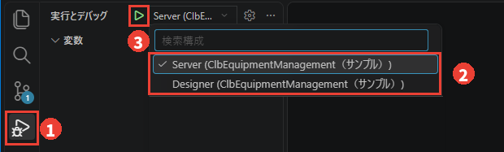
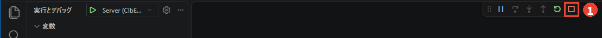

# ClbEquipmentManagement

Qiita の連載「組み込み機器と業務画面の境界・連携・現場運用」で使う共通サンプルです。
架空の設備管理アプリを、記事ごとに少しずつ育てていきます。

> 筆者は株式会社Codeerの社員で、Codeer.LowCode.Blazor（CLB）の開発元に所属しています。

## このサンプルについて

- 設備・機種・計測値などのデータは、すべて架空のものです。実在の機器や現場とは関係ありません。
- PLC・MQTT・シリアル通信・C++ との連携は、CLB の標準機能ではありません。CLB とは別に作るアダプターとして実装します。
- CLB は管理画面と業務データを担当します。リアルタイム制御には使いません。安全に関わる判断は機器側に残します。
- 学習・評価用のサンプルです。そのまま本番で使うことは想定していません。

## 対象の版

| 項目 | 版 |
| --- | --- |
| Codeer.LowCode.Blazor | 1.3.70（[CLB Starter](https://github.com/Codeer-Software/Codeer.LowCode.Blazor.Starter) のコミット 4314eff を元にしている） |
| .NET SDK | 10.0（確認は 10.0.404。`global.json` で 10.0 系に固定） |
| DB | SQLite |
| 開発環境 | VS Code（C# Dev Kit） |
| OS | （確認して記入） |

確認日：（最初のコミット時に記入）

## ライセンス

- このフォルダのコードは、リポジトリの [LICENSE](../LICENSE)（MIT）に従います。
- CLB 本体は商用製品で、MIT ではありません。評価目的であれば30日間の無料試用で動かせます。商用で使うにはライセンスが必要です。条件は [CLB製品ページ](https://www.codeer.co.jp/LowCode) で確認してください。

## フォルダ構成

```
ClbEquipmentManagement/
├─ global.json                        .NET 10 に固定
├─ CLAUDE.md、AGENTS.md               AI エージェント向けの説明（CLB Starter から）
├─ AIForDeveloper/                    AI エージェント向けの資料（CLB Starter から）
├─ .claude/                           Claude Code の共通の設定（CLB Starter から）
├─ .vscode/                           VS Code の起動・ビルドの設定
├─ Source/
│  ├─ LowCodeApp.sln
│  ├─ LowCodeApp.Server/              サーバー
│  ├─ LowCodeApp.Client/              ブラウザで動く画面（Blazor WebAssembly）
│  ├─ LowCodeApp.Client.Shared/       Server・Client・Designer で共有する部品
│  ├─ LowCodeApp.Designer/            デザイナ（Windows のアプリ）
│  └─ LowCodeApp.LicenseRegisterCli/  ライセンスを登録するコマンド
├─ DesignProjects/EquipmentManagement/
│  ├─ design/                         デザイン本体（画面とモジュールの定義）
│  ├─ designer.settings.Development.example.json   デザイナの設定の見本
│  └─ Project.md、CLAUDE.md、AGENTS.md            デザインを AI エージェントで作るときの説明
└─ Database/                          テーブル定義と架空データの SQL
                                      （000_base.sql、001_tables.sql、002_seed.sql、equipment_list.sql）
```

これから足すもの：`Simulator/`（機器シミュレーター。NAK-06 から）、`Adapters/`（MQTT・シリアル・C++ のアダプター。NAK-07 以降）。記事の進み具合に合わせて追加します。

## 動かし方

デザイナが Windows のアプリなので、Windows で動かします。

### 必要なもの

- Windows（確認は Windows 11）
- .NET 10 SDK（10.0.100 以降の 10.0 系。`global.json` で 10.0 系に固定しています）
- Git
- エディタは VS Code（C# Dev Kit）で確認しています。Visual Studio を使う場合は、Visual Studio 2026（18.0）以降が必要です。このサンプルは `net10.0` を対象にしているので、Visual Studio 2022 では開けません（.NET SDK 10.0.404 の環境では「指定された SDK 'Microsoft.NET.Sdk' は見つかりませんでした」と出ました）
- インターネット接続（最初のビルドで NuGet のパッケージを取得します）
- CLB のライセンスは要りません。30日間の無料試用で動きます（画面の右上に「試用版（実運用不可）」と出ます）。試用は最初のビルドで始まります。評価目的に限ります。

### 手順

PowerShell で、同じ画面のまま上から順に実行します（手順5で作る変数を、手順6でも使います）。

1. クローンして、このフォルダに移る。

   ```powershell
   git clone https://github.com/Codeer-Software/Codeer.Blog.Samples.git
   cd Codeer.Blog.Samples\ClbEquipmentManagement
   ```

2. DB とデザインの保存先を作る。

   ```powershell
   New-Item -ItemType Directory -Force C:\ClbEquipmentManagement.Local\Data, C:\ClbEquipmentManagement.Local\Designs, C:\ClbEquipmentManagement.Local\Storages, C:\ClbEquipmentManagement.Local\Font | Out-Null
   ```

3. デザイナの設定ファイルを、見本からコピーする。

   ```powershell
   Copy-Item DesignProjects\EquipmentManagement\designer.settings.Development.example.json DesignProjects\EquipmentManagement\design\designer.settings.Development.json
   ```

4. ビルドする。CLB の試用は、ここで始まります（デザイナのコマンドは、試用が始まっていないと動きません）。

   ```powershell
   dotnet build Source\LowCodeApp.sln
   ```

5. DB を作る（ログイン用のテーブル、設備台帳のテーブル、架空データ）。`C:\ClbEquipmentManagement.Local\Data\main.db` ができます。

   ```powershell
   $designer = (Resolve-Path "Source\LowCodeApp.Designer\bin\Debug\net10.0-windows\LowCodeApp.Designer.exe").Path
   $design   = (Resolve-Path "DesignProjects\EquipmentManagement\design").Path
   foreach ($f in "000_base", "001_tables", "002_seed") {
     $p = Start-Process -FilePath $designer -Wait -PassThru -ArgumentList @(
       "sql", $design, "--datasource", "Main",
       "--file", (Resolve-Path "Database\$f.sql").Path,
       "--out", "$env:TEMP\clb_$f.json")
     "$f : 終了コード $($p.ExitCode)"
   }
   ```

   3つとも終了コードが 0 なら成功です。0 でないときは、`$env:TEMP\clb_<ファイル名>.json` にエラーの内容が書かれています。
   テーブルがすでにあると失敗するので、最初からやり直すときは `C:\ClbEquipmentManagement.Local\Data\main.db` を消してから流します。

6. デザインをデプロイする（`C:\ClbEquipmentManagement.Local\Designs\App.zip` ができます）。

   ```powershell
   $p = Start-Process -FilePath $designer -Wait -PassThru -ArgumentList @("deploy", $design, "--out", "$env:TEMP\clb_deploy.json")
   "deploy : 終了コード $($p.ExitCode)"
   Get-Content "$env:TEMP\clb_deploy.json"
   ```

   `"success": true` なら成功です。

7. サーバーを起動して、ブラウザで開く。

   ```powershell
   dotnet run --project Source\LowCodeApp.Server --launch-profile https
   ```

   `https://localhost:7137` を開き、`admin` / `admin` でログインします。このユーザーは手元で試すためのものです。ほかの人がアクセスできる場所で動かすときは、必ずパスワードを変えてください。
   証明書の警告が出る場合は、`dotnet dev-certs https --trust` を実行して、開発用の証明書を信頼してください（Windows の確認ダイアログが出ます）。
   サーバーは、起動したターミナルで Ctrl+C を押すと止まります。

### VS Code で動かす（初めての方向け）

VS Code でコードを書いたことはあっても、アプリを動かしたことはない、という方向けの手順です。

1. **準備する。** VS Code と、拡張機能「C# Dev Kit」を入れます。このフォルダを開くと、入れることを勧める通知が右下に出ます（`.vscode/extensions.json` で勧めています）。
2. **フォルダを開く。** 「ファイル」→「フォルダーを開く」で、`ClbEquipmentManagement` フォルダを開きます。リポジトリ全体（`Codeer.Blog.Samples`）ではなく、このフォルダを開いてください。サーバーやデザイナを起動する設定（`.vscode/launch.json`）が、このフォルダにあるためです。
3. **準備のコマンドを流す。** 「表示」→「ターミナル」でターミナルを開き、上の「手順」の2〜6を実行します。
4. **サーバーを起動する。** 左の「実行とデバッグ」（下の画像の1）を開き、上のドロップダウンから「Server」を選んで（2）、隣の実行ボタン（▷、3）を押します。ビルドのあとサーバーが起動し、ブラウザが開きます。`admin` / `admin` でログインします。
   ワークスペース（`.code-workspace`）から開いた場合は、画像のように「Server (フォルダ名)」と表示されます。

   

5. **サーバーを止める。** 実行中に画面の上に出る小さなツールバーの、停止ボタン（■、下の画像の1）を押します。

   

6. **デザイナを起動する。** 同じドロップダウンで「Designer」を選び、実行ボタン（▷）を押します。設備台帳のデザインを開いた状態で、デザイナが起動します。
   見るだけのときは、変更や保存をせずに閉じてください。デザイナで保存すると、デザインのファイルが書き換わります。

記事を書いた時点のコードは、タグ（例：`NAK-04`）で見られます。

DB とファイルの保存先は、`C:\ClbEquipmentManagement.Local\` 以下を使います。
CLB Starter の初期設定（`C:\Codeer.LowCode.Blazor.Local\`）とは分けています。

## 記事との対応

記事ごとにタグを付けています。記事を書いた時点のコードは、タグを選ぶと見られます。

| タグ | 記事 | 内容 |
| --- | --- | --- |
| NAK-04 | [型番と個体を分けて、交換・移設の履歴が消えない設備台帳を作る](https://qiita.com/nakano-kenji/items/b9c5a9ec960ef241c2a6) | 型番と個体を分ける設備台帳 |

## 秘密情報について

接続文字列、ライセンスキー、パスワードなどはコミットしていません。
手元で必要な値は、各自の環境で設定してください。
